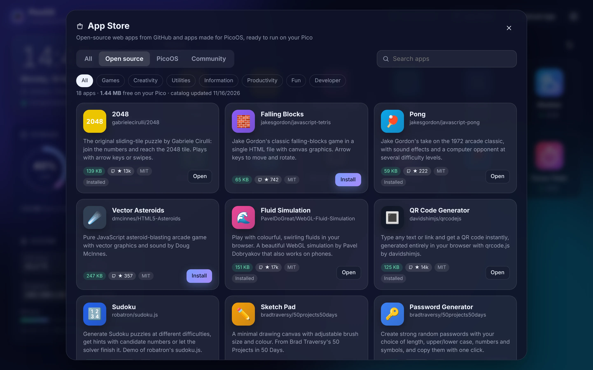
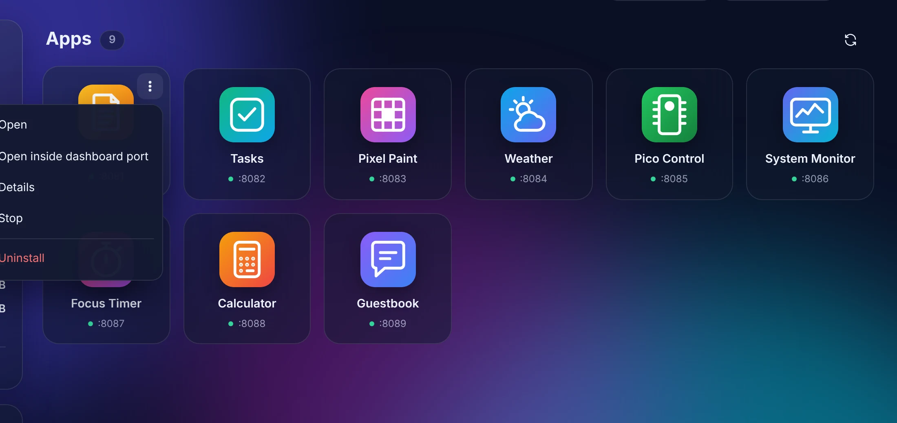
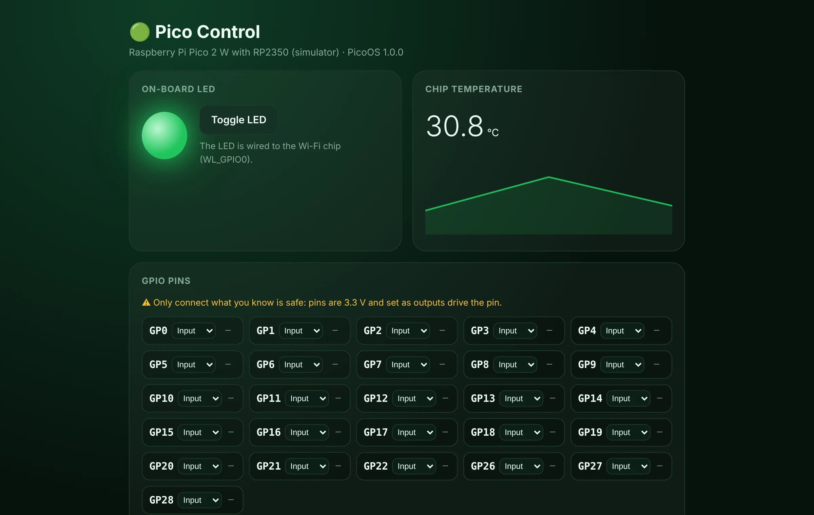
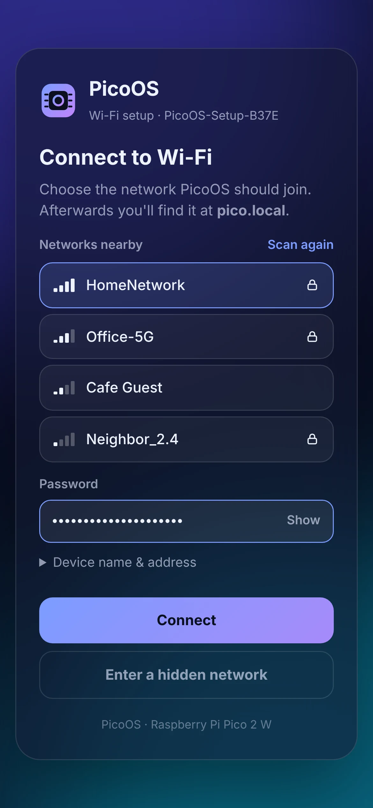

<div align="center">


# PicoOS

**A tiny home-server "operating system" for the Raspberry Pi Pico 2 W.**
Drop one `.uf2` file on the board, join it to your Wi-Fi from your phone, and get a
beautiful dashboard at **http://pico.local** with an App Store, your own web apps,
an internet-synced clock and a storage overview.

[](https://github.com/GokalpHizmetleri/PicoOS/actions/workflows/build.yml)


[**Download PicoOS-pico2w.uf2**](https://github.com/GokalpHizmetleri/PicoOS/raw/main/dist/PicoOS-pico2w.uf2) ·
[Getting started](docs/getting-started.md) ·
[User guide](docs/user-guide.md) ·
[Build your own app](docs/app-development.md)

<br>


</div>

---

## Features

| | |
|---|---|
| 📶 **Wi-Fi setup from your phone** | On first boot PicoOS opens a `PicoOS-Setup-XXXX` hotspot with a captive portal. Pick your network, type the password, done. If it ever can't connect, the setup hotspot comes back automatically. |
| 🏠 **Dashboard at `pico.local`** | A modern, glass-style home screen (inspired by home-server dashboards like CasaOS) that works on desktop and phone. |
| 🕒 **Clock for where you are** | Time comes from NTP; the time zone is detected from your internet connection's location, including daylight saving time. Manual override available. |
| 💾 **Storage at a glance** | Total, used and free flash, split into apps and system. |
| 🛍️ **App Store** | **Explore GitHub**: your browser searches GitHub, checks every repository for an HTML/CSS/JS web app that can run on a Pico (no build step, small enough) and downloads it straight from GitHub. Plus a tested *Featured* list and apps made for PicoOS. |
| ⬆️ **Upload your own apps** | Drop a single `.html` file, a folder, several files or a `.zip`. HTML, CSS, JS, images, fonts: anything a browser can run. |
| 🔌 **Every app gets its own port** | Click an app on the home screen to open it at `http://pico.local:8081`, `:8082`, … (also reachable at `/apps/<id>/`). |
| 🧰 **App SDK** | Apps can store data on the Pico, read system info and the clock, toggle the LED, use GPIO pins, and even ship a small **MicroPython backend**. |
| 📦 **One file to install** | A single UF2 with MicroPython + PicoOS + the whole web UI built in. No Thonny, no copying files. |

## Screenshots

<table>
<tr>
<td width="50%"><br><sub><b>App Store</b>: real open-source apps from GitHub, with stars, license and a free-space check</sub></td>
<td width="50%"><br><sub><b>Upload</b>: a single HTML file, a folder or a .zip</sub></td>
</tr>
<tr>
<td><br><sub><b>Settings</b>: device name, hostname, time zone, Wi-Fi, store source</sub></td>
<td><br><sub><b>App menu</b>: open, details, stop/start, uninstall</sub></td>
</tr>
<tr>
<td><br><sub><b>System Monitor</b> app (from the store)</sub></td>
<td><br><sub><b>Pico Control</b> app: LED, GPIO and temperature</sub></td>
</tr>
</table>

<p align="center">



</p>
<p align="center"><sub>Wi-Fi setup portal → connected → the dashboard on a phone</sub></p>

## Quick start

1. **Download** [`PicoOS-pico2w.uf2`](https://github.com/GokalpHizmetleri/PicoOS/raw/main/dist/PicoOS-pico2w.uf2)
   (or grab it from the [latest release](https://github.com/GokalpHizmetleri/PicoOS/releases/latest)).
2. Hold the **BOOTSEL** button on your Pico 2 W while plugging it into USB. A drive called `RP2350` appears.
3. **Copy the `.uf2` file onto that drive.** The Pico reboots into PicoOS by itself.
4. On your phone or laptop, join the Wi-Fi network **`PicoOS-Setup-XXXX`**. The setup page opens on its own
   (if it doesn't, browse to `http://192.168.4.1`).
5. Pick your Wi-Fi, enter the password and press **Connect**.
6. Switch back to your normal Wi-Fi and open **http://pico.local**. 🎉

> **LED status:** slow blink = setup hotspot running · fast blink = connecting · solid = dashboard online.
> To redo the Wi-Fi setup, press **BOOTSEL** within 2 s of powering up and hold it for 3 s, or use *Settings → Network → Forget Wi-Fi*.

More detail, including troubleshooting, is in **[docs/getting-started.md](docs/getting-started.md)**.

## The App Store

### Explore GitHub: every web app that fits

The **Explore GitHub** tab turns all of GitHub into an app store, and your browser does all the work:

1. It searches GitHub by category (Games, Browser games, Mini projects, Creative coding, WebGL,
   Tools, PWA…) or by your own search terms.
2. It checks every result: is there an `index.html` (also in `docs/`, `public/`, `dist/`… or on
   `gh-pages`)? Does it run without a build step? Are its scripts and styles really there? Is it
   small enough for the Pico's flash?
3. It shows only the projects that pass, with stars, license and size.
4. **Install** downloads the files straight from GitHub and uploads them to the Pico.

The Pico never talks to GitHub itself: no TLS, no JSON parsing of big API responses, no rate limits
on the device. Searching, checking and downloading all happen in the browser
([`firmware/web/dashboard/explore.js`](firmware/web/dashboard/explore.js)).
[`tests/explore_test.js`](tests/explore_test.js) runs this against the real GitHub, installs the
apps it finds and opens them to make sure they work.

### Featured: tested open-source apps

A hand-picked list that is tested on every refresh
([`tests/store_apps_test.js`](tests/store_apps_test.js)). PicoOS doesn't copy them: your browser downloads them from
**their own GitHub repositories** at a pinned commit. A daily CI job
([`tools/update_store.py`](tools/update_store.py)) moves the pins to each project's latest commit,
so upstream improvements arrive as **Update** buttons.

| App | Repository | License | Stars | Size |
|---|---|---|---|---|
| 🧩 2048 | [gabrielecirulli/2048](https://github.com/gabrielecirulli/2048) | MIT | ★ 13.5k | 139 KB |
| 🧱 Falling Blocks | [jakesgordon/javascript-tetris](https://github.com/jakesgordon/javascript-tetris) | MIT | ★ 742 | 65 KB |
| 🏓 Pong | [jakesgordon/javascript-pong](https://github.com/jakesgordon/javascript-pong) | MIT | ★ 222 | 59 KB |
| ☄️ Vector Asteroids | [dmcinnes/HTML5-Asteroids](https://github.com/dmcinnes/HTML5-Asteroids) | MIT | ★ 357 | 247 KB |
| 🌊 Fluid Simulation | [PavelDoGreat/WebGL-Fluid-Simulation](https://github.com/PavelDoGreat/WebGL-Fluid-Simulation) | MIT | ★ 16.8k | 151 KB |
| 🔳 QR Code Generator | [davidshimjs/qrcodejs](https://github.com/davidshimjs/qrcodejs) | MIT | ★ 14.3k | 125 KB |
| 🔢 Sudoku | [robatron/sudoku.js](https://github.com/robatron/sudoku.js) | MIT | ★ 499 | 319 KB |
| ✏️ Sketch Pad | [bradtraversy/50projects50days](https://github.com/bradtraversy/50projects50days/tree/master/drawing-app) | MIT | ★ 40.6k | 3.0 KB |
| 🔑 Password Generator | [bradtraversy/50projects50days](https://github.com/bradtraversy/50projects50days/tree/master/password-generator) | MIT | ★ 40.6k | 5.1 KB |
| 🕰️ Analog Clock | [bradtraversy/50projects50days](https://github.com/bradtraversy/50projects50days/tree/master/theme-clock) | MIT | ★ 40.6k | 4.8 KB |
| 💧 Drink Water | [bradtraversy/50projects50days](https://github.com/bradtraversy/50projects50days/tree/master/drink-water) | MIT | ★ 40.6k | 4.1 KB |
| 🐞 Catch the Insect | [bradtraversy/50projects50days](https://github.com/bradtraversy/50projects50days/tree/master/insect-catch-game) | MIT | ★ 40.6k | 6.1 KB |
| ❓ Quiz | [bradtraversy/50projects50days](https://github.com/bradtraversy/50projects50days/tree/master/quiz-app) | MIT | ★ 40.6k | 4.5 KB |
| 🎲 Random Picker | [bradtraversy/50projects50days](https://github.com/bradtraversy/50projects50days/tree/master/random-choice-picker) | MIT | ★ 40.6k | 2.8 KB |
| 🔊 Sound Board | [bradtraversy/50projects50days](https://github.com/bradtraversy/50projects50days/tree/master/sound-board) | MIT | ★ 40.6k | 232 KB |
| ⌨️ Key Codes | [bradtraversy/50projects50days](https://github.com/bradtraversy/50projects50days/tree/master/event-keycodes) | MIT | ★ 40.6k | 1.5 KB |
| 😄 Dad Jokes | [bradtraversy/50projects50days](https://github.com/bradtraversy/50projects50days/tree/master/dad-jokes) | MIT | ★ 40.6k | 2.2 KB |
| 🖼️ Photo Cards | [bradtraversy/50projects50days](https://github.com/bradtraversy/50projects50days/tree/master/expanding-cards) | MIT | ★ 40.6k | 2.7 KB |

The list lives in [`store/sources.json`](store/sources.json). To add a project, see
[Listing an existing open-source project](docs/app-development.md#listing-an-existing-open-source-project).
The CI job also **discovers** new small, build-free web projects through GitHub search.

### Made for PicoOS

Apps that use the PicoOS SDK, for example to store data on the Pico or control its LED and GPIO:

| App | What it does | Size |
|---|---|---|
| 🧮 Calculator | A clean calculator with keyboard support, percentage, sign toggle and a running history of your last results | 4.9 KB |
| ⏱️ Focus Timer | A focus/break interval timer with a progress ring, gentle chime and a daily session counter | 5.7 KB |
| 💬 Guestbook | Let visitors on your network leave a message | 5.1 KB |
| 👋 Hello World | The starter template for building your own PicoOS app | 3.6 KB |
| 📝 Notes | Quick notes saved directly on your Pico, so they follow you to every device on your network | 5.5 KB |
| 🟢 Pico Control | Toggle the on-board LED and drive or read GPIO pins of your Pico 2 W from the browser, with a live chip temperature graph | 6.1 KB |
| 🎨 Pixel Paint | Draw 16×16 or 32×32 pixel art with a palette, fill bucket and eraser | 6.3 KB |
| 📈 System Monitor | Live graphs of memory usage and chip temperature, storage breakdown per app and uptime of your PicoOS device | 5.0 KB |
| ✅ Tasks | A simple to-do list with priorities and filters | 5.4 KB |
| 🌦️ Weather | Current conditions, hourly and 7-day forecast for your location | 6.9 KB |

### Your own repository

Any public repository with a ready-to-run `index.html` can be found through *Explore GitHub*. Add the
topic **`picoos-app`** and it is also listed under the *PicoOS apps* category.
See [Publishing an app](docs/app-development.md#publishing-your-app).

## How it works

```
┌───────────────────────────── Raspberry Pi Pico 2 W ─────────────────────────────┐
│  MicroPython 1.29 (RP2350, CYW43439 Wi-Fi, lwIP + mDNS "pico.local")            │
│  ├─ PicoOS (frozen into flash)                                                  │
│  │   ├─ boot:  saved Wi-Fi? ── no/fails ──► setup AP + captive DNS + portal :80 │
│  │   │                       └─ connected ──► dashboard + REST API on :80       │
│  │   ├─ time:  NTP + IP geolocation (time zone, DST)                            │
│  │   └─ apps:  one asyncio web server per app on :8081 … :8100 + app SDK        │
│  └─ LittleFS (2.5 MB): /.picoos/config.json, /apps/<id>/{app.json, www/, data/}  │
└─────────────────────────────────────────────────────────────────────────────────┘
          ▲                                      ▲
          │ http://pico.local                    │ App Store: your browser downloads the app
   your browser ─────────────────────────────────┘ from GitHub and uploads it to the Pico
```

The browser does the downloading from GitHub, so the Pico never has to do TLS. That keeps installs
fast and reliable. Details are in [docs/architecture.md](docs/architecture.md).

## Documentation

| Guide | |
|---|---|
| [Getting started](docs/getting-started.md) | Flashing, Wi-Fi setup, LED codes, recovery, troubleshooting |
| [User guide](docs/user-guide.md) | Dashboard, App Store, uploading apps, settings |
| [App development](docs/app-development.md) | App format, `picoos.json`, the SDK, Python backends, publishing |
| [Architecture & API](docs/architecture.md) | Boot flow, filesystem layout, ports, full HTTP API reference |
| [Building from source](docs/building.md) | Building the UF2, the desktop simulator, tests |

## Develop without hardware

```bash
python3 tools/simulator.py            # dashboard on http://localhost:8080
python3 tools/simulator.py --setup    # the Wi-Fi setup portal
python3 tests/smoke_test.py           # end-to-end API tests
```

The simulator runs the real PicoOS code on your computer with fake Wi-Fi/GPIO.
See [docs/building.md](docs/building.md).

## Building the firmware

```bash
sudo apt install gcc-arm-none-eabi libnewlib-arm-none-eabi cmake python3 git
./tools/build_firmware.sh             # → dist/PicoOS-pico2w.uf2
```

## Requirements & limits

- **Raspberry Pi Pico 2 W** (RP2350 + CYW43439). The original Pico W (RP2040) is not supported by this image.
- 2.4 GHz Wi-Fi (WPA/WPA2 or open). The Pico's radio can't join 5 GHz-only networks.
- About **2.2 MB** of flash for apps, up to **20 apps** at once.
- Apps are static web apps (plus optional small MicroPython backends). PicoOS doesn't run Node, PHP or Docker.
- PicoOS has no login. Use it on a network you trust. See [Security](docs/architecture.md#security).

## License

MIT, see [LICENSE](LICENSE). PicoOS is built on [MicroPython](https://micropython.org) (MIT).
Not affiliated with Raspberry Pi Ltd or CasaOS.
