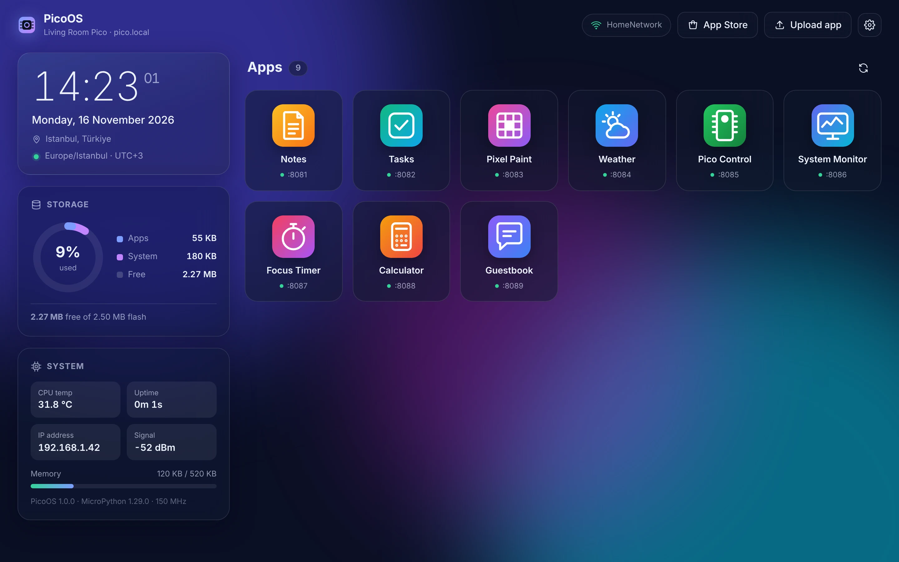
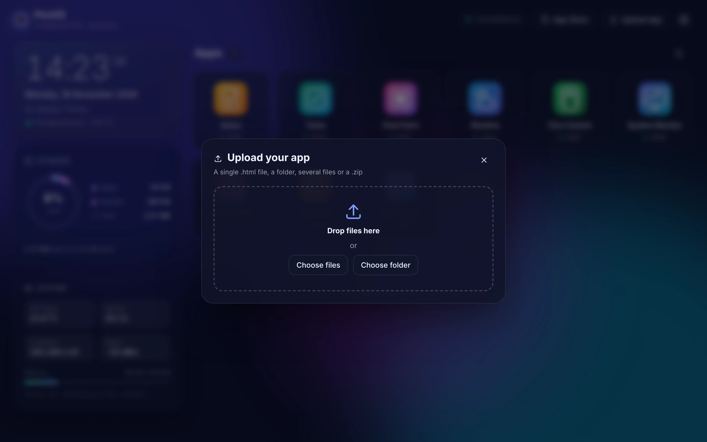
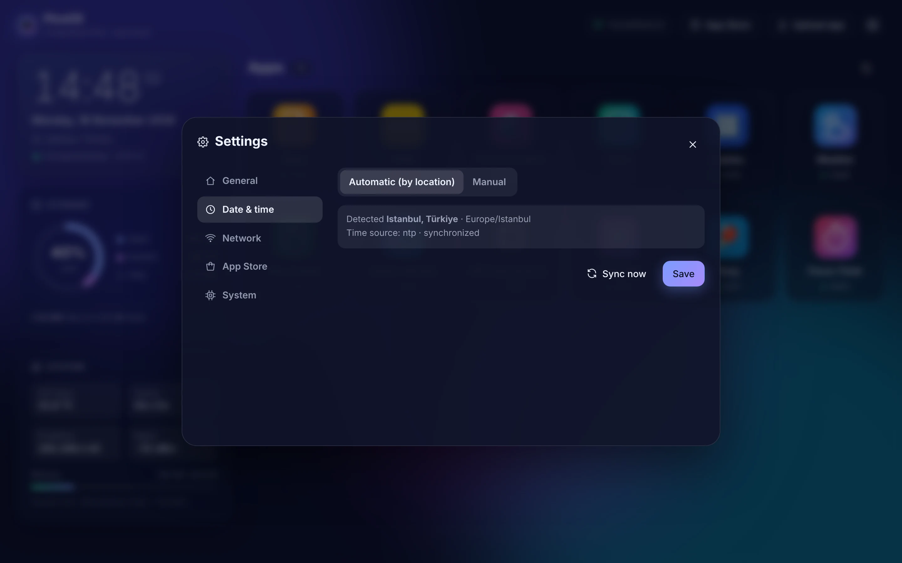
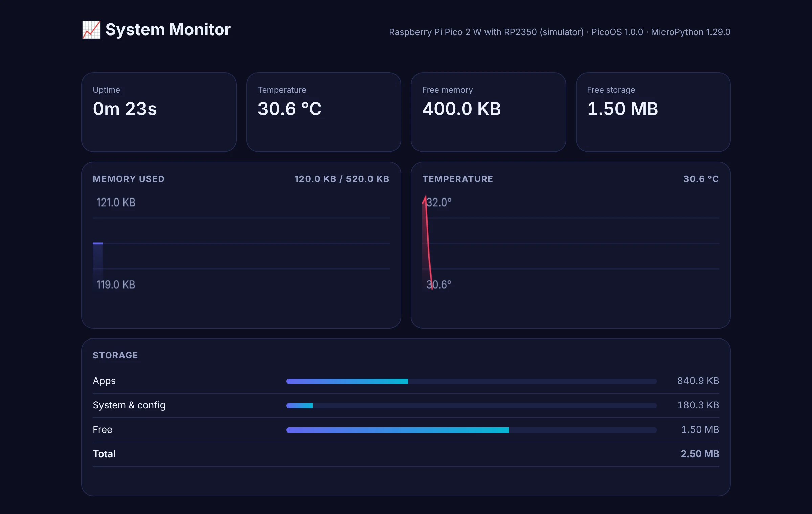
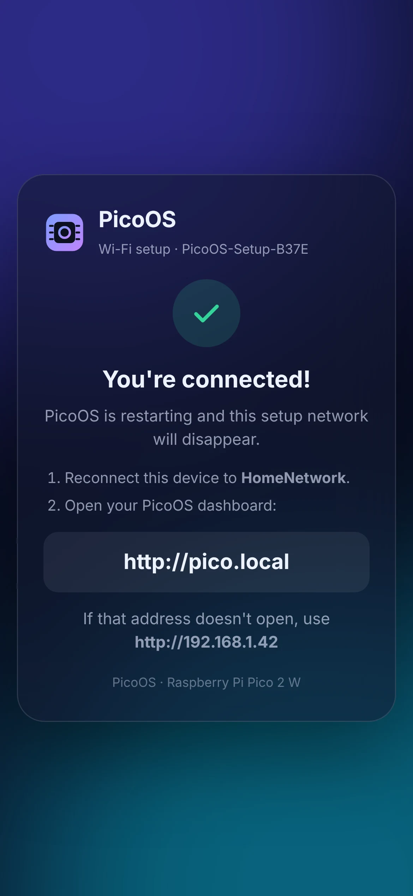
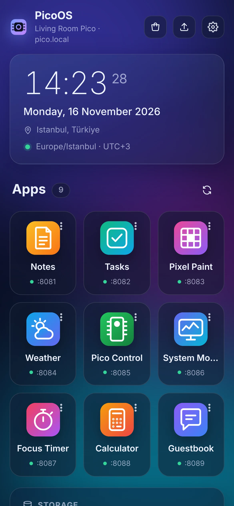

<div align="center">


# PicoOS

**A tiny home-server "operating system" for the Raspberry Pi Pico 2 W.**
Drop one `.uf2` file on the board, join it to your Wi-Fi from your phone, and get a
beautiful dashboard at **http://pico.local** with an App Store, your own web apps,
an internet-synced clock and a storage overview.

[](https://github.com/GokalpHizmetleri/PicoOS/actions/workflows/build.yml)


[**Download PicoOS-pico2w.uf2**](https://github.com/GokalpHizmetleri/PicoOS/raw/main/dist/PicoOS-pico2w.uf2) ·
[Getting started](docs/getting-started.md) ·
[User guide](docs/user-guide.md) ·
[Build your own app](docs/app-development.md)

<br>



</div>

---

## Features

| | |
|---|---|
| 📶 **Wi-Fi setup from your phone** | On first boot PicoOS opens a `PicoOS-Setup-XXXX` hotspot with a captive portal. Pick your network, type the password, done. If it ever can't connect, the setup hotspot comes back automatically. |
| 🏠 **Dashboard at `pico.local`** | A modern, glass-style home screen (inspired by home-server dashboards like CasaOS) that works on desktop and phone. |
| 🕒 **Clock for where you are** | Time comes from NTP; the time zone is detected from your internet connection's location, including daylight saving time. Manual override available. |
| 💾 **Storage at a glance** | Total, used and free flash, split into apps and system. |
| 🛍️ **App Store** | Official apps come from this repository's `store/` folder, plus community apps from any public GitHub repo tagged `picoos-app`. It's always up to date, and it checks free space before installing. |
| ⬆️ **Upload your own apps** | Drop a single `.html` file, a folder, several files or a `.zip`. HTML, CSS, JS, images, fonts: anything a browser can run. |
| 🔌 **Every app gets its own port** | Click an app on the home screen to open it at `http://pico.local:8081`, `:8082`, … (also reachable at `/apps/<id>/`). |
| 🧰 **App SDK** | Apps can store data on the Pico, read system info and the clock, toggle the LED, use GPIO pins, and even ship a small **MicroPython backend**. |
| 📦 **One file to install** | A single UF2 with MicroPython + PicoOS + the whole web UI built in. No Thonny, no copying files. |

## Screenshots

<table>
<tr>
<td width="50%"><br><sub><b>App Store</b>: official and community apps, with a free-space check</sub></td>
<td width="50%"><br><sub><b>Upload</b>: a single HTML file, a folder or a .zip</sub></td>
</tr>
<tr>
<td><br><sub><b>Settings</b>: device name, hostname, time zone, Wi-Fi, store source</sub></td>
<td><br><sub><b>App menu</b>: open, details, stop/start, uninstall</sub></td>
</tr>
<tr>
<td><br><sub><b>System Monitor</b> app (from the store)</sub></td>
<td><br><sub><b>Pico Control</b> app: LED, GPIO and temperature</sub></td>
</tr>
</table>

<p align="center">



</p>
<p align="center"><sub>Wi-Fi setup portal → connected → the dashboard on a phone</sub></p>

## Quick start

1. **Download** [`PicoOS-pico2w.uf2`](https://github.com/GokalpHizmetleri/PicoOS/raw/main/dist/PicoOS-pico2w.uf2)
   (or grab it from the [latest release](https://github.com/GokalpHizmetleri/PicoOS/releases/latest)).
2. Hold the **BOOTSEL** button on your Pico 2 W while plugging it into USB. A drive called `RP2350` appears.
3. **Copy the `.uf2` file onto that drive.** The Pico reboots into PicoOS by itself.
4. On your phone or laptop, join the Wi-Fi network **`PicoOS-Setup-XXXX`**. The setup page opens on its own
   (if it doesn't, browse to `http://192.168.4.1`).
5. Pick your Wi-Fi, enter the password and press **Connect**.
6. Switch back to your normal Wi-Fi and open **http://pico.local**. 🎉

> **LED status:** slow blink = setup hotspot running · fast blink = connecting · solid = dashboard online.
> To redo the Wi-Fi setup, press **BOOTSEL** within 2 s of powering up and hold it for 3 s, or use *Settings → Network → Forget Wi-Fi*.

More detail, including troubleshooting, is in **[docs/getting-started.md](docs/getting-started.md)**.

## The App Store

The official store ships these apps. All of them are small, original and made for PicoOS:

| App | What it does | Size |
|---|---|---|
| 📝 Notes | Notes stored on the Pico, shared by all your devices | 5.5 KB |
| ✅ Tasks | To-do list with priorities | 5.4 KB |
| ⏱️ Focus Timer | Focus/break timer, can blink the Pico LED | 5.7 KB |
| 🎨 Pixel Paint | 16×16 / 32×32 pixel art with a gallery saved on the Pico | 6.3 KB |
| 🌦️ Weather | Forecast for the location PicoOS detected (Open-Meteo) | 6.9 KB |
| 🟢 Pico Control | On-board LED, GPIO pins and chip temperature | 6.1 KB |
| 📈 System Monitor | Live memory/temperature graphs and storage breakdown | 5.0 KB |
| 🧮 Calculator | Calculator with keyboard support | 4.9 KB |
| 💬 Guestbook | Example app with a **MicroPython backend** | 5.1 KB |
| 👋 Hello World | Starter template for your own apps | 3.6 KB |

The catalog (`store/catalog.json`) is regenerated by CI on every push, so new apps and updates appear
in every PicoOS dashboard right away. **Community apps** show up automatically when a public GitHub
repository has the topic `picoos-app`. See [Publishing an app](docs/app-development.md#publishing-your-app).

## How it works

```
┌───────────────────────────── Raspberry Pi Pico 2 W ─────────────────────────────┐
│  MicroPython 1.29 (RP2350, CYW43439 Wi-Fi, lwIP + mDNS "pico.local")            │
│  ├─ PicoOS (frozen into flash)                                                  │
│  │   ├─ boot:  saved Wi-Fi? ── no/fails ──► setup AP + captive DNS + portal :80 │
│  │   │                       └─ connected ──► dashboard + REST API on :80       │
│  │   ├─ time:  NTP + IP geolocation (time zone, DST)                            │
│  │   └─ apps:  one asyncio web server per app on :8081 … :8100 + app SDK        │
│  └─ LittleFS (2.5 MB): /.picoos/config.json, /apps/<id>/{app.json, www/, data/}  │
└─────────────────────────────────────────────────────────────────────────────────┘
          ▲                                      ▲
          │ http://pico.local                    │ App Store: your browser downloads the app
   your browser ─────────────────────────────────┘ from GitHub and uploads it to the Pico
```

The browser does the downloading from GitHub, so the Pico never has to do TLS. That keeps installs
fast and reliable. Details are in [docs/architecture.md](docs/architecture.md).

## Documentation

| Guide | |
|---|---|
| [Getting started](docs/getting-started.md) | Flashing, Wi-Fi setup, LED codes, recovery, troubleshooting |
| [User guide](docs/user-guide.md) | Dashboard, App Store, uploading apps, settings |
| [App development](docs/app-development.md) | App format, `picoos.json`, the SDK, Python backends, publishing |
| [Architecture & API](docs/architecture.md) | Boot flow, filesystem layout, ports, full HTTP API reference |
| [Building from source](docs/building.md) | Building the UF2, the desktop simulator, tests |

## Develop without hardware

```bash
python3 tools/simulator.py            # dashboard on http://localhost:8080
python3 tools/simulator.py --setup    # the Wi-Fi setup portal
python3 tests/smoke_test.py           # end-to-end API tests
```

The simulator runs the real PicoOS code on your computer with fake Wi-Fi/GPIO.
See [docs/building.md](docs/building.md).

## Building the firmware

```bash
sudo apt install gcc-arm-none-eabi libnewlib-arm-none-eabi cmake python3 git
./tools/build_firmware.sh             # → dist/PicoOS-pico2w.uf2
```

## Requirements & limits

- **Raspberry Pi Pico 2 W** (RP2350 + CYW43439). The original Pico W (RP2040) is not supported by this image.
- 2.4 GHz Wi-Fi (WPA/WPA2 or open). The Pico's radio can't join 5 GHz-only networks.
- About **2.2 MB** of flash for apps, up to **20 apps** at once.
- Apps are static web apps (plus optional small MicroPython backends). PicoOS doesn't run Node, PHP or Docker.
- PicoOS has no login. Use it on a network you trust. See [Security](docs/architecture.md#security).

## License

MIT, see [LICENSE](LICENSE). PicoOS is built on [MicroPython](https://micropython.org) (MIT).
Not affiliated with Raspberry Pi Ltd or CasaOS.
