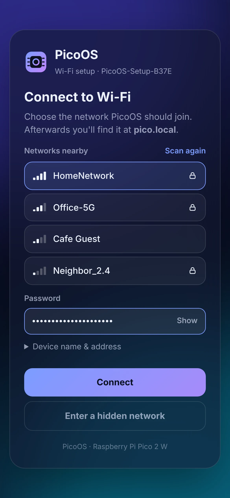
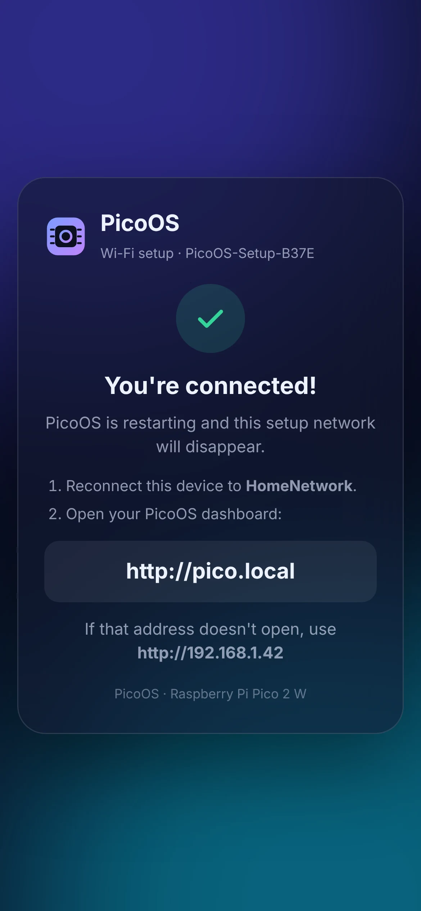
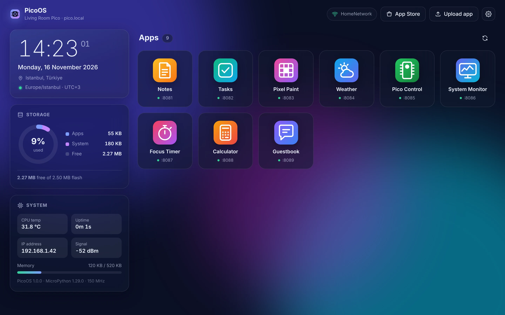

# Getting started

This guide takes you from a brand-new Raspberry Pi Pico 2 W to a running PicoOS dashboard in about
five minutes.

- [What you need](#what-you-need)
- [1. Flash PicoOS](#1-flash-picoos)
- [2. Connect it to your Wi-Fi](#2-connect-it-to-your-wi-fi)
- [3. Open the dashboard](#3-open-the-dashboard)
- [LED status codes](#led-status-codes)
- [What happens when Wi-Fi fails](#what-happens-when-wi-fi-fails)
- [Resetting the Wi-Fi settings](#resetting-the-wi-fi-settings)
- [Updating PicoOS](#updating-picoos)
- [Factory reset](#factory-reset-erase-everything)
- [Troubleshooting](#troubleshooting)

## What you need

- A **Raspberry Pi Pico 2 W** (the RP2350 board with Wi-Fi; the board says "Pico 2 W")
- A USB cable that carries **data**, not just power
- A 2.4 GHz Wi-Fi network
- A phone or computer with a web browser

## 1. Flash PicoOS

1. Download **[`PicoOS-pico2w.uf2`](https://github.com/GokalpHizmetleri/PicoOS/raw/main/dist/PicoOS-pico2w.uf2)**.
   Each release is also listed on the [Releases page](https://github.com/GokalpHizmetleri/PicoOS/releases).
2. Hold down the white **BOOTSEL** button on the Pico.
3. Keep holding it while you plug the Pico into your computer, then let go.
4. A USB drive called **`RP2350`** appears.
5. Drag `PicoOS-pico2w.uf2` onto that drive.

The drive disappears and the Pico restarts into PicoOS. The first boot formats the internal
filesystem, which takes a couple of seconds.

> PicoOS is a complete MicroPython firmware with PicoOS built in. You don't need Thonny, `mpremote`
> or to copy any other files.

## 2. Connect it to your Wi-Fi

With no saved network, PicoOS starts its own access point. The LED blinks slowly.

1. On your phone or laptop, open the Wi-Fi list and join **`PicoOS-Setup-XXXX`**
   (`XXXX` is the end of the board's MAC address). The network is open, with no password.
2. A setup page should pop up by itself (a "captive portal"). If it doesn't, open a browser and go
   to **http://192.168.4.1**.
3. Tap your network in the list. Use **Enter a hidden network** if it doesn't broadcast its name.
4. Type the Wi-Fi password.
5. Optional: open **Device name & address** to choose a name and a hostname. With the hostname
   `kitchen` the dashboard will be at `http://kitchen.local`.
6. Press **Connect**.

 

PicoOS tests the password while the setup page stays open:

- **Wrong password / network not found:** you see the error right away and can try again.
- **Success:** the page shows the address to open and the IP address. About 9 seconds later PicoOS
  restarts in normal mode and the setup network disappears.

Sometimes your phone briefly drops off the setup network while the Pico joins your router (the
radio may have to change channel). In that case the page says *Almost there*. That usually means it
worked.

## 3. Open the dashboard

Reconnect your phone or computer to your normal Wi-Fi and open:

### **http://pico.local**

If `pico.local` doesn't open, use the IP address shown at the end of setup (for example
`http://192.168.1.42`), or look the Pico up in your router's device list. See
[Troubleshooting](#pico-local-doesnt-open).

Next: the **[user guide](user-guide.md)** covers the App Store, uploading your own apps and settings.

## LED status codes

| LED | Meaning |
|---|---|
| Slow blink (1×/s) | Setup access point is running and waiting for you |
| Fast blink | Connecting to your Wi-Fi |
| Solid on | Connected, and the dashboard is online |
| Blinking for 2 s right after power-up | Window for the BOOTSEL Wi-Fi reset |
| Rapid flicker while holding BOOTSEL | Wi-Fi reset countdown (see below) |

## What happens when Wi-Fi fails

When PicoOS starts with a saved network, it makes **3 attempts** to connect (about 20 s each).

- If they all fail (router off, password changed, out of range), PicoOS **starts the setup access
  point again**. The setup page shows a red banner with the reason, for example
  *Could not connect to "HomeNetwork": Wrong password*.
- While the access point is up, PicoOS **keeps retrying the saved network every 3 minutes**, as long
  as nobody is connected to the setup network. After a power cut the Pico may boot faster than your
  router; when the router comes back, PicoOS reconnects by itself.
- If the connection drops while the dashboard is running, PicoOS reconnects in the background. If the
  network stays unreachable for about 5 minutes, it restarts and goes through the steps above.

## Resetting the Wi-Fi settings

Any of these works:

- **From the dashboard:** *Settings → Network → Forget Wi-Fi & restart setup*.
- **With the button:** plug the Pico in, then **within 2 seconds press BOOTSEL and hold it for
  3 seconds**. Don't hold it *while* plugging in, because that opens the USB drive for flashing. During
  the first 2 seconds after power-up the LED blinks to show the window is open; while you hold
  BOOTSEL it flickers fast. Release it after the flicker stops: the saved Wi-Fi is erased and the
  setup access point starts. Apps and their data are kept.
- **Change networks without resetting:** *Settings → Network → Change Wi-Fi network*.

## Updating PicoOS

Flash a newer `PicoOS-pico2w.uf2` the same way as the first time (BOOTSEL + copy).
Your **settings, installed apps and app data are kept**: they live in the filesystem part of the
flash, which a firmware update doesn't touch.

## Factory reset (erase everything)

To wipe all apps, data and settings, flash Raspberry Pi's
[`flash_nuke.uf2`](https://datasheets.raspberrypi.com/soft/flash_nuke.uf2) (it supports RP2350),
then flash PicoOS again.

## Troubleshooting

### `pico.local` doesn't open

`.local` names use mDNS (also called Bonjour/Zeroconf).

- **Windows 10/11, macOS, iOS, most Linux distributions:** supported out of the box. On Linux,
  `avahi-daemon` must be running.
- **Android:** support depends on the browser and Android version. If it doesn't work, use the IP
  address. Tip: bookmark the dashboard once you have opened it by IP.
- Some routers block multicast between Wi-Fi clients ("AP/client isolation", common on guest
  networks). Turn that off or use the IP address.
- Using a VPN on your device can also stop `.local` from resolving.

To find the IP address: it is shown at the end of the setup, in your router's device list (look for
`pico` or your hostname), and on the USB serial console (see below).

### The setup network doesn't appear

- Make sure you flashed the **Pico 2 W** image onto a **Pico 2 W**. Plain Pico/Pico 2 boards have no
  radio, and the original Pico W (RP2040) needs a different firmware.
- Wait 10–15 seconds after power-up. If a Wi-Fi network is saved, PicoOS tries it 3 times first.
- Clear the saved network: press BOOTSEL within 2 seconds of power-up and hold it for 3 seconds.

### My network isn't in the list

- The Pico 2 W only supports **2.4 GHz**. Dual-band routers usually work; a 5 GHz-only network won't.
- Tap **Scan again**, or use **Enter a hidden network**.
- WPA3-only networks may not work. Use WPA2 or WPA2/WPA3 mixed mode.

### An app shows "Not enough space"

The Pico has about 2.2 MB free for apps. Uninstall apps you don't use (⋮ → *Uninstall*). Files are
stored in 4 KB blocks, so many tiny files take more room than their raw size.

### An app doesn't open

- Check that the app is running (green dot under its icon). If not, open ⋮ → *Start*.
- Some networks block ports above 8080. Try ⋮ → *Open inside dashboard port*, which serves the same
  app from `http://pico.local/apps/<id>/`.

### Looking at the logs

- In the dashboard: *Settings → System → Logs*.
- Over USB: open the Pico's serial port at 115200 baud (with `mpremote`, PuTTY, screen, or the
  Arduino/Thonny serial monitor). PicoOS prints every step, including the IP address.
  Press **Ctrl+C** to stop PicoOS and get a MicroPython REPL; press **Ctrl+D** to restart it.
