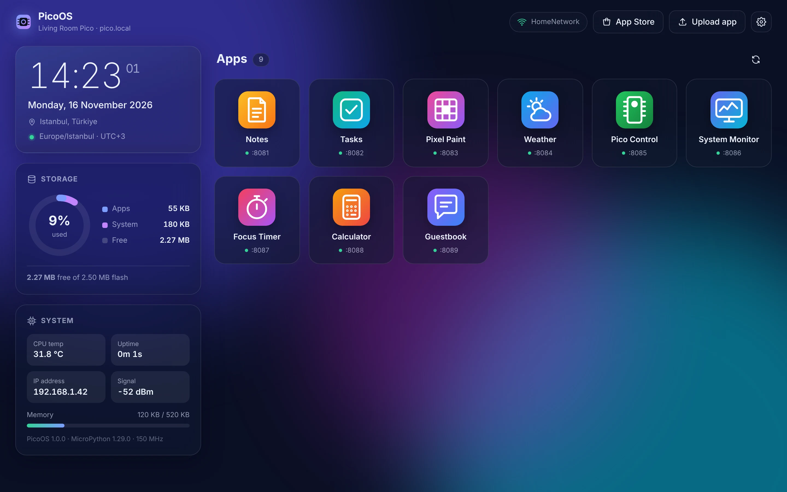
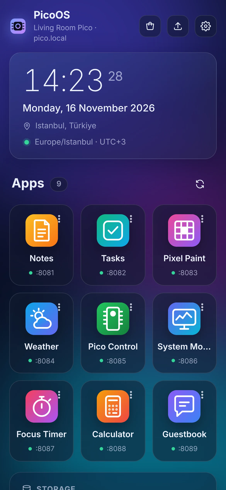
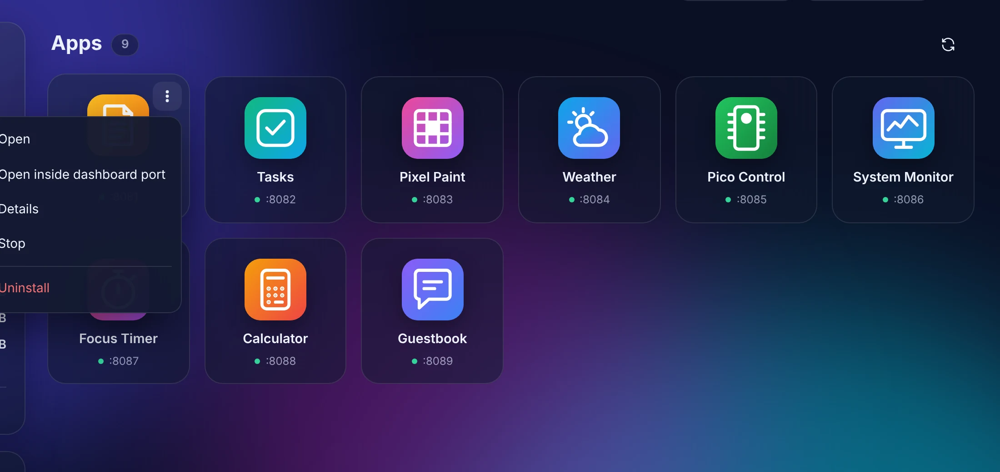
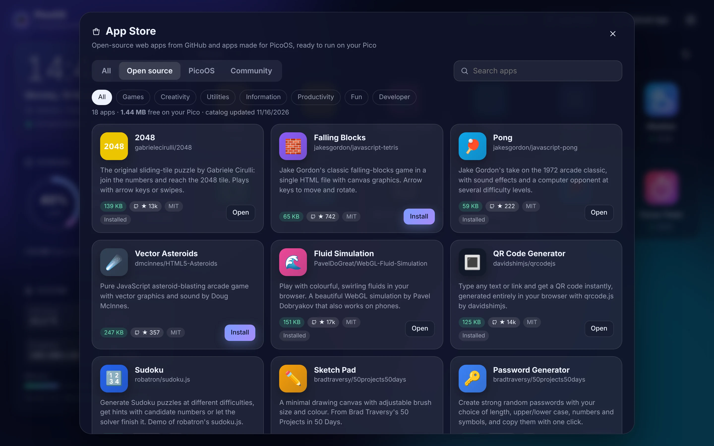
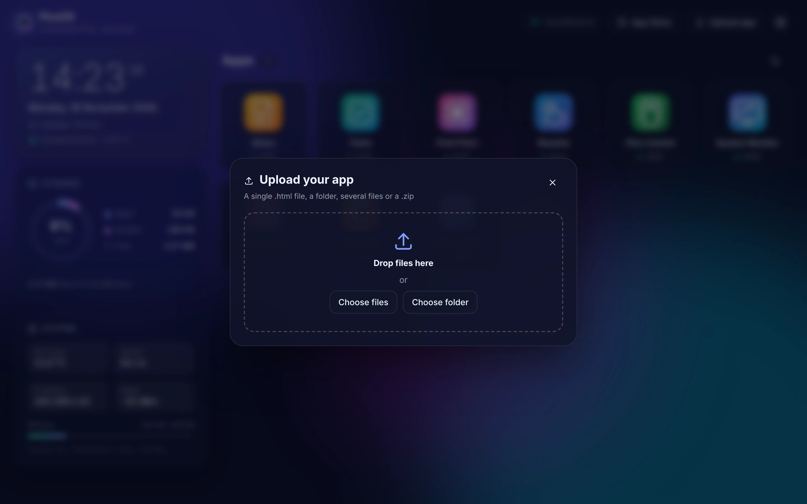

# User guide

- [The dashboard](#the-dashboard)
- [Opening and managing apps](#opening-and-managing-apps)
- [The App Store](#the-app-store)
- [Uploading your own app](#uploading-your-own-app)
- [Settings](#settings)

## The dashboard

Open **http://pico.local** (or the hostname you chose) on any device in your network.

| Area | What it shows |
|---|---|
| **Top bar** | Device name and address, the Wi-Fi network (click it for network details), **App Store**, **Upload app** and **Settings** |
| **Clock** | Local time and date for your location, the detected city, time zone and UTC offset. A green dot means the clock is synchronized with the internet. |
| **Storage** | Ring chart of used flash, split into **Apps** (your installed apps and their data) and **System** (configuration, filesystem overhead), plus free space |
| **System** | Chip temperature, uptime, IP address, Wi-Fi signal strength, memory usage, PicoOS/MicroPython version and CPU clock |
| **Apps** | All installed apps. A green dot and the port number mean the app is running. |

The dashboard refreshes itself every 10 seconds. If the Pico becomes unreachable, a red banner appears
at the top and disappears again once it's back.

### Where does the time come from?

The clock is **not** your device's clock. The Pico sets its own clock from NTP time servers
(`pool.ntp.org`, `time.google.com`, `time.cloudflare.com`). It then asks
[ip-api.com](https://ip-api.com) where your internet connection is located, which gives the city and
the time zone offset, including daylight saving time. The offset is refreshed every 6 hours, so DST
changes are picked up automatically. If you'd rather set the time zone yourself, see
[Date & time](#date--time).

On a phone the layout stacks: clock, then apps, then storage and system.

## Opening and managing apps

**Click an app** to open it in a new tab. Every app is a small website with its own port:
`http://pico.local:8081`, `http://pico.local:8082`, and so on.

Hover over an app and click **⋮** (or right-click / long-press it) for more options:

| Action | |
|---|---|
| **Open** | Opens the app on its own port |
| **Open inside dashboard port** | Opens the same app at `http://pico.local/apps/<id>/`. Useful if your network blocks high ports. |
| **Details** | Version, author, size, source (store, community or upload), address |
| **Stop / Start** | A stopped app keeps its files and data but doesn't run a web server |
| **Uninstall** | Deletes the app **and its saved data** |

## The App Store

Click **App Store** in the top bar.

The store has three tabs:

| Tab | What's in it |
|---|---|
| **Explore GitHub** | **Every** HTML/CSS/JS web app on GitHub that can run on your Pico, found live by your browser (details below) |
| **Featured** | A hand-picked, tested list: 2048, Sudoku, Pong, a WebGL fluid simulation, a QR generator and more, refreshed from their repositories daily |
| **Made for PicoOS** | Apps that use the PicoOS SDK (notes and tasks stored on the Pico, Pico Control, System Monitor…) |

### Explore GitHub

This tab is a live search of GitHub. **All the work happens in your browser**; the Pico only
receives the finished files.

1. Pick a category (*Popular, Games, Browser games, JavaScript games, Vanilla JS, Mini projects,
   Creative coding, Canvas & WebGL, Tools, PWA, PicoOS apps*) or type anything into the search box
   and press Enter, for example `snake`, `pomodoro`, `markdown editor` or `tetris`.
2. Your browser asks GitHub for matching repositories (30 per page) and checks **each one**:
   - it looks for an `index.html` in the repository root and in `docs/`, `public/`, `dist/`,
     `build/`, `www/`, `site/`, `app/`, `web/`, `src/`, `demo/`… and on the `gh-pages` branch
     (where many projects publish their ready-built site);
   - it reads the start page and rejects projects that **need a build step** (TypeScript/JSX/Vue
     entry files, Jekyll or template syntax);
   - it checks that the scripts and stylesheets the page loads are actually in the repository;
   - it keeps only the files a browser needs (HTML, CSS, JS, images, fonts, sounds, WebAssembly…)
     and checks the total size (max 2 MB / 150 files) against the free space on your Pico.
3. Only apps that pass are shown (untick **Only apps that run on the Pico** to see the rest, each
   with the reason it was rejected). If a page has few runnable apps, the next pages are checked
   automatically; **Load more** goes further.
4. **Install** downloads every file straight from `raw.githubusercontent.com` and uploads it to the
   Pico. The app gets its own port like any other app.

Cards show the repository, stars, license, size and last update. **Update** appears when the
repository has new commits since you installed it. Sites built for GitHub Pages that expect to live
under `/<repository-name>/` work too, because PicoOS maps that path to the app.

> **GitHub limits:** without an account GitHub allows about 10 searches per minute, which is plenty
> for browsing. If you hit the limit, wait a minute, or add a free personal access token in
> *Settings → App Store*. The token stays in your browser and is only sent to api.github.com.
> Results are cached in your browser, so going back to a category doesn't cost extra searches.

### Things to know
Every card shows the app's size. The size tag is **green** when it fits in the Pico's free space and
**red** when it doesn't. The button changes to match:

| Button | Meaning |
|---|---|
| **Install** | Fits; click to install |
| **Update** | Installed, and a newer version is available. Updating keeps the app's port and its saved data. |
| **Open** | Installed and up to date |
| **No space** | Not enough free flash; uninstall something first |
| **Too big** | Bigger than the Pico's whole storage |

When you click **Install**, *your browser* downloads the app's files from GitHub (for open-source
apps: straight from the project's repository, at the exact commit listed in the catalog) and uploads
them to the Pico, with a progress bar on the card. The browser therefore needs internet access; the Pico
itself only talks to your local network during the install. When the install finishes, the app
appears on the home screen and is already running.

> The store reads from `GokalpHizmetleri/PicoOS@main` by default. You can point it at a fork or
> branch in *Settings → App Store*.

## Uploading your own app

Click **Upload app**. You can give PicoOS:

| Input | Example |
|---|---|
| A single HTML file | `game.html` with inline CSS/JS |
| Several files | `index.html`, `style.css`, `app.js`, `logo.png` |
| A folder | Choose folder → your project folder (subfolders are kept) |
| A `.zip` archive | A zipped project; one top-level folder inside the zip is removed automatically |

You can also drag and drop any of these onto the upload area.

Then:

1. Check the **name** (taken from the page's `<title>`) and the **App ID** (used in the URL, a–z,
   0–9, `-`, `_`).
2. Pick the **start page** if there is more than one HTML file.
3. Choose an **icon**. If your upload contains `icon.svg`/`icon.png` (or `favicon.svg/png`), that
   file is used instead.
4. The green/red box tells you whether it fits, including LittleFS block overhead.
5. Press **Install**.

Uploading with the ID of an app that's already installed replaces that app but keeps its data and port.

If the upload contains a `backend.py`, PicoOS runs it as the app's
[MicroPython backend](app-development.md#python-backends).

Want your app to read and store data on the Pico? See **[App development](app-development.md)**.

## Settings

Click the ⚙️ button.

### General
- **Device name**: shown in the dashboard and the browser tab.
- **Hostname**: the dashboard address is `http://<hostname>.local`. Changing it restarts PicoOS,
  and the dashboard moves to the new address.
- **Wallpaper**: six built-in backgrounds.
- **12-hour clock**: stored in this browser only.

### Date & time
- **Automatic (by location)**: time zone from IP geolocation (default).
- **Manual**: choose a UTC offset and an optional label. Use this if you're behind a VPN or the
  detected location is wrong. Manual offsets don't change for daylight saving time automatically.
- **Sync now**: syncs NTP and the location immediately.

### Network
- Current network, IP address, signal strength, MAC address.
- **Change Wi-Fi network**: scan, choose, enter a password, and PicoOS restarts on the new
  network. If that fails, the setup access point appears.
- **Forget Wi-Fi & restart setup**: back to the first-run setup.

### App Store
- **Repository / branch** the official catalog is loaded from (`owner/repo` + branch). Change it to
  run your own app store from a fork.

### System
- Version information, **Restart PicoOS**, and the **log** of the last ~120 events (connections,
  installs, errors).
